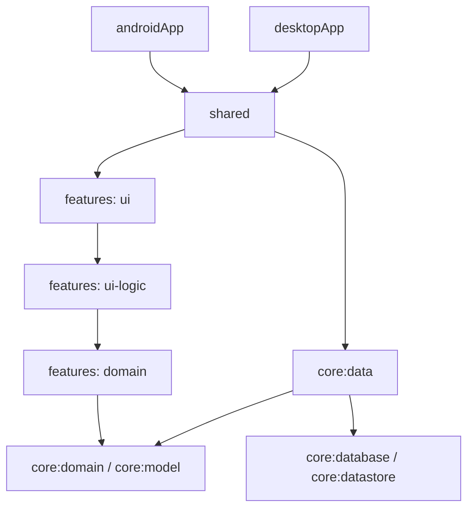

# SudokuGame

A Sudoku game for Android and desktop, written in Kotlin with Compose
Multiplatform. Both applications share screens, ViewModels, game rules,
navigation, dependency injection and persistence. The application has home, game,
history and settings features, with puzzle generation/solving provided by QQWing.

## Getting started

Requirements:

- JDK 21.
- Android SDK with platform 37 installed. Set `sdk.dir` in the untracked
  `local.properties` file, or configure `ANDROID_HOME`.
- A physical Android device running API 26 or newer to verify the Android app.

Use the checked-in Gradle wrapper; a separate Gradle installation is unnecessary.
The first build downloads dependencies from the configured repositories.
On Windows, use `gradlew.bat` in place of `./gradlew`.

```shell
# Build the Android debug APK
./gradlew :androidApp:assembleDebug

# Install on a connected physical device
./gradlew :androidApp:installDebug

# Run the desktop application on the current OS
./gradlew :desktopApp:run
```

The APK is written to `androidApp/build/outputs/apk/debug/`. Desktop data is stored
in `~/.sudoku/`: the Room database is named `sudoku`, and preferences are stored in
`settings.preferences_pb`.

## Project layout

```text
androidApp/             Android entry point and platform configuration
desktopApp/             Desktop JVM entry point
shared/                 Shared application UI and Metro dependency graph
core/                   Reusable logic, data, platform adapters and UI
features/
  home/                 Start and continue a game
  game/                 Game screen and gameplay state
  history/              Previously played games
  settings/             Application and gameplay preferences
config/                 Detekt rules and Compose compiler stability configuration
gradle/
  build-logic/          Convention plugins (included Gradle build)
  libs.versions.toml    Dependency, plugin, SDK, JVM and application versions
  wrapper/              Gradle wrapper configuration
.github/workflows/      CI checks
```

[`settings.gradle.kts`](settings.gradle.kts) is the list of included modules.
All `core`, `features` and `shared` modules are Kotlin Multiplatform libraries
with Android and JVM targets. `androidApp` and `desktopApp` are platform launchers.

### Application modules

| Module | Responsibility |
| --- | --- |
| `:shared` | `SudokuApp`, main screen/ViewModel, navigation host, Metro `AppGraph`, repository/DAO bindings and the shared ViewModel factory. Assembles all feature layers. |
| `:androidApp` | `Application`, `MainActivity`, splash screen, Android graph creation, manifest, launcher resources, signing, shrinking and Tracer configuration. Supplies Android database and DataStore instances to the shared graph. |
| `:desktopApp` | JVM `main`, Compose desktop window and graph creation using files in `~/.sudoku`. Reads the application version from a build-generated resource. |

### Core modules

| Module | Responsibility |
| --- | --- |
| `:core:common` | Coroutine dispatchers, logging, configuration and DI helpers. Supplies the Android and Swing main-dispatcher integrations. |
| `:core:model` | Domain models: boards, notes, game mode/difficulty/status, saved games and history. |
| `:core:domain` | Repository and data-source contracts for boards, saved games, history and settings. |
| `:core:game` | QQWing solver/generator, its threaded controller and Sudoku utilities. |
| `:core:data` | Repository/data-source implementations and mappings between domain models and persistence models. |
| `:core:database:entities` | Room entities for boards, saved games and history. |
| `:core:database:data` | Room database, DAOs, generated database constructor, platform database builders and schema files. JVM uses bundled SQLite. |
| `:core:datastore` | Preferences DataStore wrapper, preference models and platform creation functions. |
| `:core:navigation` | Destinations, navigation intents and navigator implementation. |
| `:core:feature` | Shared feature helpers mapping game models to presentation resources. |
| `:core:designsystem` | Theme, colors, typography, fonts and ripple implementations. |
| `:core:ui` | Reusable Compose components, board drawing helpers, common strings/images and platform UI adapters. |

### Feature layers

Each feature has the same three modules:

| Layer | Contents | Convention |
| --- | --- | --- |
| `:features:<name>:domain` | Feature use cases and business operations over core contracts. | `app.feature.domain` |
| `:features:<name>:ui-logic` | ViewModel, UI state/actions, presentation mappings and navigation requests. Depends on the feature's `domain`. | `app.feature.ui.logic` |
| `:features:<name>:ui` | Compose screen and feature components/resources. Depends on the feature's `ui-logic`. | `app.feature.ui` |

The shared application composes the feature screens and graph contributions.
Repository implementations live in `core:data`; feature use cases consume the
contracts in `core:domain`.



The diagram shows the main layer relationships; individual module scripts
declare additional dependencies on shared UI, navigation, game and utility
modules.

## Source sets and platform code

- `commonMain`: shared Kotlin logic, ViewModels, Compose screens, Room definitions
  and DataStore operations.
- `androidMain`: Android implementations, including native drawing, database and
  DataStore creation, and platform date formatting.
- `jvmMain`: desktop JVM implementations of those platform APIs.
- `core:game/src/jvmAndroidMain`: the QQWing controller shared by Android and JVM;
  this module explicitly connects both platform source sets to it.
- `commonTest` and `jvmTest`: shared and JVM tests. KMP modules using `app.test`
  also enable Android host tests; device tests in `core:database:data` live in
  `androidDeviceTest`.

Compose resources live in `commonMain/composeResources`, with shared UI strings
in `core:ui`, fonts in `core:designsystem`, and feature artwork in feature UI
modules. Resource packages are declared in the owning module scripts.
Android launcher resources remain in `androidApp/src/main/res`.

Metro creates the shared dependency graph. Each launcher constructs the
platform database and preferences store, then passes them to
`AppGraph.Factory`. This keeps platform entry points small while sharing the
application composition.

## Build configuration

Shared build rules live in the
[convention plugins](gradle/build-logic/README.md). That README lists every plugin,
its dependencies, usage examples and Compose compiler diagnostic options.
Feature scripts apply a single layer convention; core and application modules
compose the conventions they need.

[`gradle/libs.versions.toml`](gradle/libs.versions.toml) is the source of dependency
and plugin versions, Android SDK levels, JVM version and application version.
Keep module-specific settings and dependencies in the owning `build.gradle.kts`.

### Android signing and Tracer

Debug builds use the configured signing key when available, otherwise the
standard Android debug key. Release signing accepts either:

- `Keys.repo` pointing to a directory containing `google-play-publish.properties`
  with `RELEASE_STORE_FILE`, `RELEASE_STORE_PASS`, `RELEASE_KEY_ALIAS` and
  `RELEASE_KEY_PASS`.
- `keys/android-signing-keystore.jks` in the project root, together with
  `SIGNING_KEYSTORE_PASSWORD`, `SIGNING_KEY_ALIAS` and `SIGNING_KEY_PASSWORD`
  environment variables.

The checked-in `gradle.properties` sets `Keys.repo=../../.signing`; override it
with `-PKeys.repo=...` when needed. A release intended for distribution needs valid
signing credentials. The Android module also reads `tracer-pluginToken` and
`tracer-appToken` from the untracked `local.properties` file for Tracer uploads.

## Tests and checks

```shell
# Tests across all KMP modules
./gradlew jvmTest

# Android launcher unit tests, Android build and desktop compilation
./gradlew :androidApp:testDebugUnitTest :androidApp:assembleDebug :desktopApp:compileKotlin

# Static analysis of the Kotlin sources
./gradlew detekt

# Convention plugin compilation and validation
./gradlew -p gradle/build-logic :convention:check

# Instrumented tests on a connected physical Android device
./gradlew :core:database:data:connectedAndroidDeviceTest :androidApp:connectedDebugAndroidTest
```

Verify changed Android flows on a physical Android device and Desktop flows by
launching the built application on physical hardware with the target OS. See
[the repository verification rules](AGENTS.md).

Tests cover game/model behavior, feature use cases and game state, navigation,
data mappings, JVM persistence, graph creation and desktop rendering.
Test reports live under each module's `build/reports/tests/`; Detekt reports live
under `build/reports/detekt/` in the corresponding module.

The [CI workflow](.github/workflows/check-build.yml) runs Detekt, JVM tests and
the Android debug build on JDK 21 for each push.

## License

See [LICENSE](LICENSE). QQWing-derived sources retain their own copyright and
license notices in the source files.
